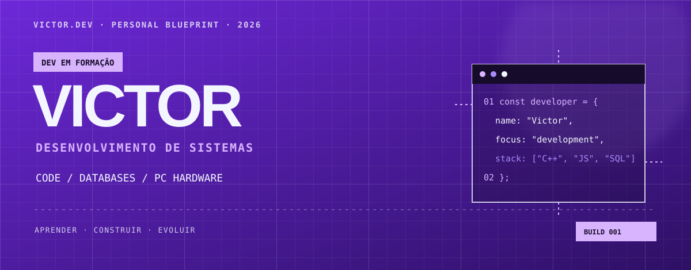

<!-- VICTOR | PROFILE README — midnight / electric violet -->

## `01 / SOBRE MIM`

Sou estudante de **Desenvolvimento de Sistemas** e curto explorar tecnologia por diferentes lados: escrever código, trabalhar com dados e entender o hardware que faz tudo funcionar.

- **Programação:** C++, JavaScript, HTML e CSS.
- **Banco de dados:** estudando SQL e MySQL.
- **Hardware:** componentes, montagem de PCs, compatibilidade, desempenho e diagnóstico.
- **Desenvolvimento web:** criação de páginas e projetos para pequenos negócios.

## `02 / TECH STACK`

| Área | Tecnologias e conhecimentos |
|:--|:--|
| Linguagens | `C++` · `JavaScript` · `HTML5` · `CSS3` |
| Banco de dados | `SQL` · `MySQL` |
| Ferramentas | `Git` · `GitHub` · `VS Code` |
| Hardware | Montagem · Compatibilidade · Diagnóstico · Desempenho |

## `03 / PROJETOS EM DESTAQUE`

Projetos e experiências que estou desenvolvendo:

| Projeto | Sobre |
|:--|:--|
| [Shopping do Real](https://github.com/victorvichi-dev/shopping-do-real) | Projeto web para divulgação de ofertas. |
| [AgroCão Petshop](https://github.com/victorvichi-dev/agro-cao-petshop) | Página web para um petshop. |
| [POP Papelaria](https://github.com/victorvichi-dev/pop-papelaria) | Projeto de página para uma papelaria. |
| [Landing Page Curinga](https://github.com/victorvichi-dev/LandingPage-Curinga) | Projeto de landing page. |

## `04 / ALÉM DO CÓDIGO`

Também gosto de montar, configurar e entender computadores. Tenho interesse especial em compatibilidade entre peças, plataformas, processadores, placas de vídeo e otimização de desempenho.

---

**Sempre aprendendo. Sempre construindo.**

Feito por Victor · <a href="https://github.com/victorvichi-dev">GitHub</a>

